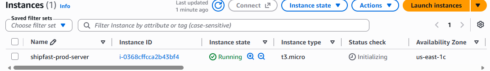
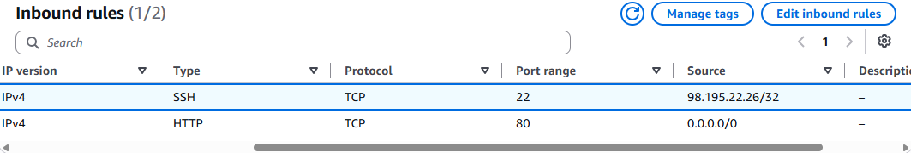
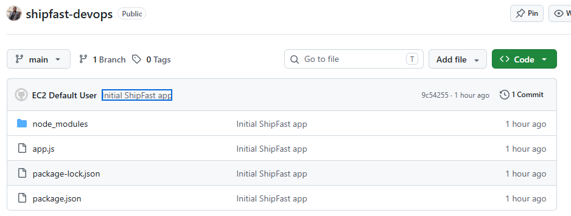
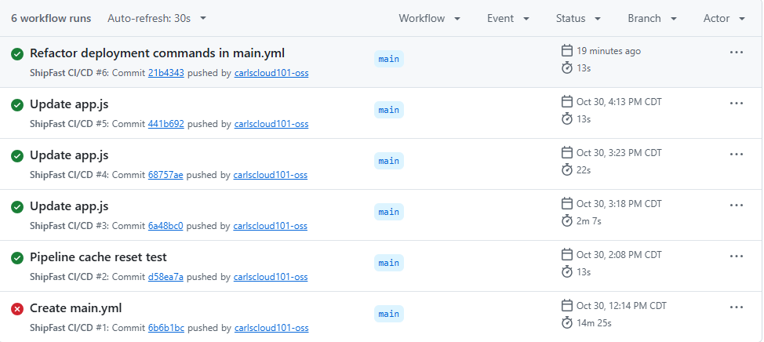
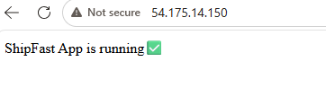
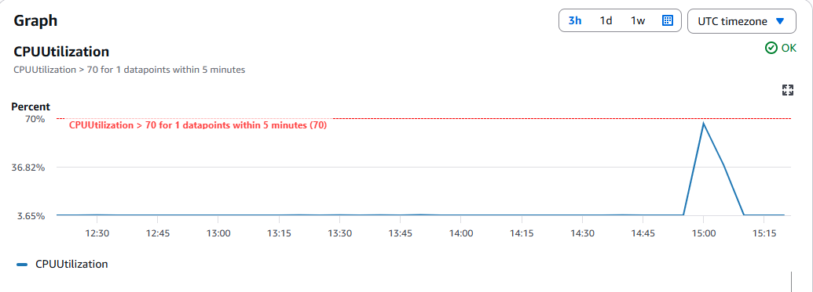
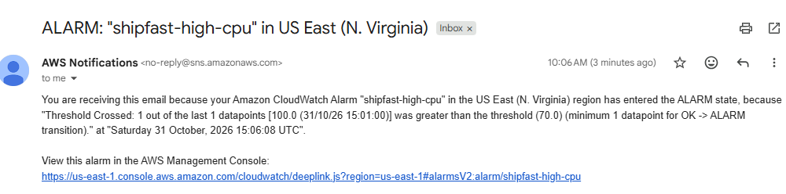

# ShipFast AWS Production Deployment & CI/CD Pipeline

A production-grade cloud deployment architecture hosting a high-performance Node.js application on AWS.

## 🏢 System Architecture Overview
This infrastructure acts as a master translator across three operational layers:
1. **Infrastructure Layer (Cloud):** AWS EC2 instance managing compute and firewalls (Port 80/22).
2. **Operating System Layer (Manager):** Amazon Linux 2023 OS handling low-level resource scheduling.
3. **Application Layer (User Interface):** Node.js runtime managed by PM2 and mapped via Nginx proxy.

## 🛠️ Tech Stack & Tooling Verification
* **Cloud Provider:** AWS (EC2, VPC, Security Groups)
* **Web Server:** Nginx (Reverse Proxy)
* **Process Manager:** PM2 (Runtime Protection)
* **CI/CD Pipeline:** GitHub Actions
* **Monitoring:** AWS CloudWatch & AWS SNS

### 🖥️ Core Infrastructure Map
#### AWS EC2 Instance Execution Proof

#### Inbound Network Security Firewall Group

---

## 🚀 Automated Deployment Workflow (CI/CD)
When code is committed to the repository, the automated conveyor belt triggers the execution loop:
1. Negotiates a secure SSH cryptographic handshake using repository secrets (`EC2_KEY`, `EC2_IP`, `EC2_USER`).
2. Pulls down the latest code changes and syncs files securely to `/var/www/shipfast/`.
3. Updates runtime dependencies via `npm install`.
4. Instructs PM2 to flush memory cache blocks to hot-reload changes with zero downtime.

#### Source Code Repository Control Panel

#### CI/CD Pipeline Conveyor Belt History

#### Live Application View (User Interface Layer)

---

## ⚠️ Infrastructure Monitoring & Stress Testing
Real-time system health instrumentation is established using AWS CloudWatch:
* **Metric Monitored:** CPU Utilization > 70% evaluated over a 5-minute window.
* **Alert Mechanism:** Connected to an AWS SNS email notification topic (`shipfast-alerts`).

#### CloudWatch Monitor Metrics Graph Spike

#### Automated SNS Incident Inbox Notification

